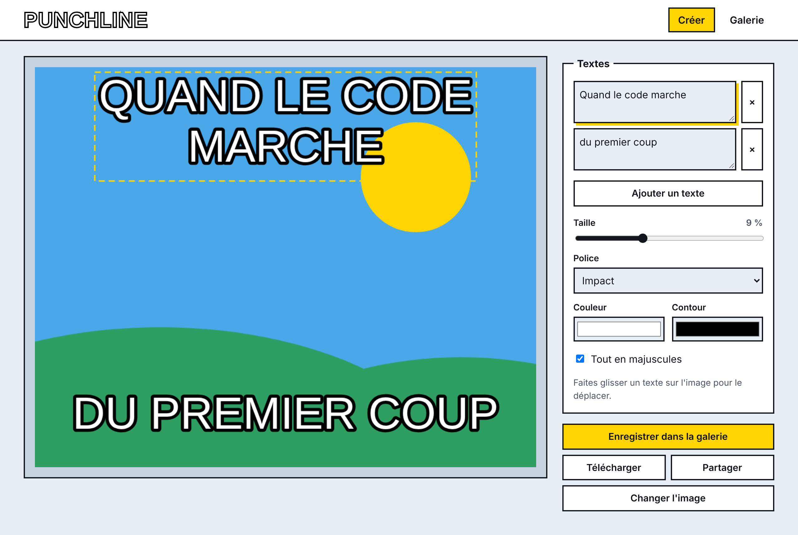
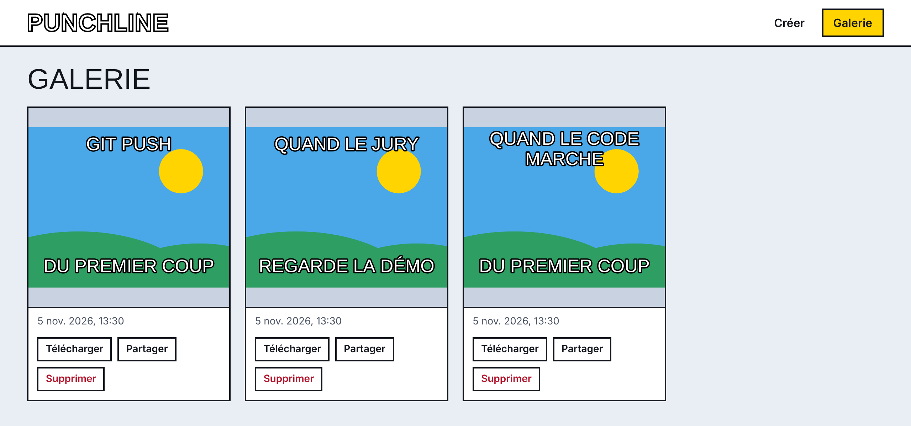
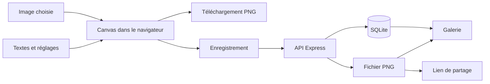

<div align="center">

# PUNCHLINE

**Créez, téléchargez et partagez vos mèmes en quelques secondes.**


[Fonctionnalités](#fonctionnalités) · [Installation](#installation) · [Structure](#structure) · [API](#api)

</div>



## À propos

Punchline est un générateur de mèmes en ligne réalisé pour le mini-projet d'admission SUPINFO. L'image reste dans le navigateur pendant l'édition et n'est envoyée au serveur que si l'utilisateur enregistre son mème.

## Fonctionnalités

| Fonctionnalité | Détail |
|---|---|
| **Import d'images** | Bouton ou glisser-déposer : JPG, PNG, WebP ou GIF jusqu'à 15 Mo |
| **Ajout de texte** | Plusieurs textes, avec taille, police, couleurs et position réglables |
| **Aperçu en temps réel** | Canvas redessiné à chaque modification |
| **Téléchargement** | Export du mème en PNG |
| **Partage** | Lien public, X, Facebook et WhatsApp |
| **Galerie** | Mèmes enregistrés, avec suppression réservée à leur créateur |



## Outils

| Outil | Rôle |
|---|---|
| HTML, CSS, JavaScript | Interface, sans framework |
| API Canvas | Dessin du mème, aperçu et export PNG |
| Node.js 20 ou plus | Exécution du serveur |
| Express 5 | Serveur web et API REST |
| Multer | Réception des images envoyées au serveur |
| SQLite (better-sqlite3) | Données de la galerie |
| Git et GitHub | Versionnement et hébergement du code |
| Claude (IA) | Assistance à la conception et au développement |

## Installation

```bash
git clone https://github.com/othmanealpro-crypto/PunchLine-MemeGenerator.git
cd PunchLine-MemeGenerator
npm install
npm run dev
```

Ouvrez ensuite http://localhost:3000. Si ce port est occupé, lancez `PORT=3001 npm run dev`.

## Structure

```text
PunchLine-MemeGenerator/
├── docs/                   # Captures du README
├── public/
│   ├── index.html          # Page de l'application
│   ├── css/
│   │   └── style.css       # Styles
│   └── js/
│       ├── app.js          # Initialisation et navigation
│       ├── editor.js       # Image, texte et aperçu Canvas
│       ├── gallery.js      # Affichage de la galerie
│       ├── share.js        # Téléchargement et partage
│       └── api.js          # Appels au backend
├── server/
│   ├── index.js            # Démarrage du serveur Express
│   ├── db.js               # Connexion SQLite et table memes
│   └── routes/
│       └── memes.js        # Routes de l'API
├── storage/                # Images et base, créés au lancement (non versionné)
├── package.json
└── README.md
```

## Fonctionnement



## API

| Méthode | Route | Action |
|---|---|---|
| `GET` | `/api/memes` | Lister les mèmes |
| `POST` | `/api/memes` | Enregistrer un PNG (champs `image` et `caption`) |
| `DELETE` | `/api/memes/:id` | Supprimer un mème (en-tête `x-delete-token`) |
| `GET` | `/memes/:fichier` | Afficher l'image publique |

## Sécurité

- Le serveur vérifie la signature PNG et limite les envois à 10 Mo.
- Les noms de fichiers sont générés par le serveur.
- Seul le navigateur qui a créé un mème peut le supprimer, grâce à un jeton gardé en local.

## Déploiement

Les variables `PORT` et `STORAGE_DIR` sont prises en charge. `STORAGE_DIR` doit pointer vers un disque persistant, sinon les mèmes seront perdus au redémarrage du serveur.
